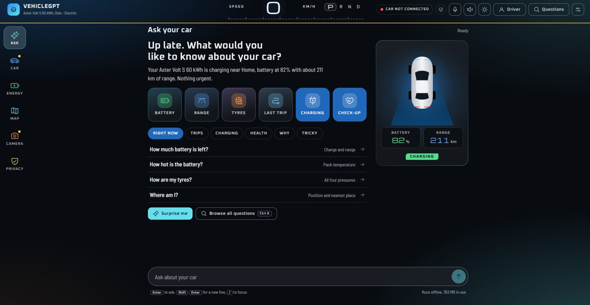
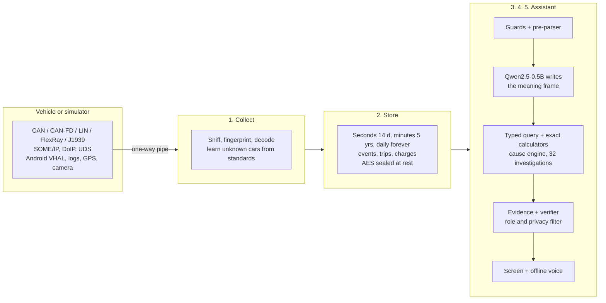

<div align="center">

# VANTAGE

### Ask your car anything. On the car. With no cloud.

An on-device vehicle assistant: a **0.5-billion-parameter language model** reads your question, and plain, tested code does every calculation. It runs offline on a **2-core, 2 GB** board.

    -C51A4A)



</div>

---

> "Why has my driving range reduced over the last two weeks?"
>
> *Your estimated range fell about 26% (298 to 222 km) because energy use rose 34%. Main reasons: colder weather, which raised climate-control use, and more highway driving (47% to 74% of distance). There was also a sudden jump on 21 Sept: check for added drag such as a roof box.*

> "what happened before the battery overheating warning?"
>
> *Battery temperature went 20.9 to 52.0 C and coolant flow fell from 10.1 to 4.0 L/min while a DC fast charge was running. Probable cause: coolant flow collapsed while the pack heated. Check the pump and coolant level.*

Every number in an answer comes from your car's own recorded data, is shown with its evidence, and is checked before you see it. If the data can't support an answer, VANTAGE says so instead of guessing.

## Why it is different

| | Typical "chat with your car" | VANTAGE |
|---|---|---|
| Where it runs | Cloud | **On the car. A guard in the process refuses every network socket.** |
| Who does the maths | The language model (and may invent numbers) | **Code.** The model never writes a number, a query or a command. |
| What the model writes | Free text | **An 8-word "meaning frame"** from a closed vocabulary, so hostile input can't steer it |
| Wrong data | Smoothed over | Flagged, dropped or reported as "cannot be checked" |
| "Why did that happen?" | A plausible story | A cause engine that ranks causes, shows what was ruled out, and can answer "nothing changed enough to need a cause" |
| Safety | Trust the model | **Structure**: read-only database handle, receive-only data link, no code path that can transmit on a bus |
| Cars | One | **Any**: the receiver recognises an unknown car from its raw bytes |

## How it works



1. **Collect.** A one-way pipe carries raw vehicle traffic. VANTAGE sniffs what each channel carries, matches the car against installed decoder files, or learns a new decoder from the standards (OBD-II, J1939, VHAL, NMEA). The signal mapper refuses rather than guesses: 0 wrong mappings on 831 reviewed signals from 76 real vehicle databases.
2. **Store.** One writer, tiered SQLite, a lossless archive and a size budget. Five years of minutes fit in 6 GB.
3. **Read the question.** Spelling and shorthand repair (every repair is shown as "I read it as ..."), then a small model with a trained adapter writes the frame. Below 0.50 calibrated confidence it answers "I will not guess".
4. **Calculate.** The frame becomes a typed query. The only SQL in the system is built from fixed templates and run on a read-only handle. Executors do the statistics, trends, event rates, trips, charging and fuel economy.
5. **Answer.** Templates write the words, a verifier rejects any number the evidence doesn't hold, and role rules decide who sees what.

Deep dive: [`documentation/`](documentation/README.md) is a 17-chapter end-to-end write-up of the design, the history (including everything that was tried and thrown away), the measurements and the limits.

## What's in the box

- **13 protocol families**, each cross-checked against an independent implementation (cantools, can-j1939, udsoncan, scapy, python-canopen and others) and, for ISO-TP and J1939, against the Linux kernel's own stacks on a real Raspberry Pi.
- **49 simulated cars** (25 from real open CAN databases): electric, petrol, diesel and hybrid, detected from the data, never from a setting.
- **A cockpit UI** in plain JS and CSS, fully offline, with fonts and icons bundled.
- **Four roles** (driver, service engineer, fleet operator, validation team) with different access, scrypt passcodes and a hash-chained audit log.
- **Offline voice**: wake word "Vantage", local speech recognition and local voices.
- **Safety isolation measured on a Raspberry Pi 4**: a 100 Hz, 1 ms-deadline real-time task missed 0 deadlines in 10 stress scenarios, and 22 of 22 escape attempts were refused.
- **A native int8 engine** (hand-written C with ARM assembly kernels) plus ONNX Runtime and llama.cpp backends.
- **About 1,770 tests.**

## Honest numbers

We would rather you trust these than be impressed by them.

| Measure | Result |
|---|---|
| Question understanding, exact 8-word frame, 3,842 questions | **90.0%** overall; 91.5% on older sets, **84.3% on unseen wording** |
| Confidence | Questions the model is at least 95% sure of are right 95.7% of the time. Below 0.50 it refuses. |
| Latency, Raspberry Pi 4, 2 cores | median about 1.1 s; about 8% of questions still over 2 s |
| Memory, Raspberry Pi 4 | about 0.7 to 1.3 GB resident |
| Cause engine, sealed test, 74 scenarios | first answer right 87.8%, top three 95.9%, 0% confident false causes on negative controls |

**Known limits** (full list in [`documentation/13_limitations_and_roadmap.md`](documentation/13_limitations_and_roadmap.md)):
- **No real vehicle has ever been attached.** Every car is a recording or a simulation replayed as real wire traffic.
- Accuracy is measured on questions written by the project's own authors. We need outside testers.
- Roughly 1 question in 6 on unseen wording is read differently from what was meant, and most of those mistakes are made with high confidence.
- It is a hybrid, and says so: a learned model decides what a question means, and visible rules (spelling repair, a few no-model questions) sit in front of it.

## Quick start

```bash
git clone https://github.com/RishithSahu/vantage.git
cd vantage
pip install -r requirements.txt            # numpy, opencv-headless, cryptography
python vehiclegpt.py doctor                # checks this machine and tells you what to fix
python -m pytest -q tests                  # the suite; the small test corpus is included
```

**Model files are not in this repository.** The base model (Qwen2.5-0.5B-Instruct, Q4_K_M GGUF) and the trained adapter go in `models/`, and `models/product.json` names them. Large data (the four-year car histories) is generated with `tools_build_worlds.py`. Without the model, the rule-based paths and all non-model tests still run. We plan to publish the adapter as a release asset; see the issues.

```bash
python vehiclegpt.py                       # the app in its own window
python vehiclegpt.py car aster_ev --instant   # in another terminal: a simulated car
python vehiclegpt.py run --linked          # the assistant reading that car over the pipe
python vehiclegpt.py ingest capture.csv --db data/mycar.db   # any candump/ASC/BLF/CSV/JSON capture
```

See [`documentation/12_operations_guide.md`](documentation/12_operations_guide.md) for every command and environment switch, and [`USER_GUIDE.md`](USER_GUIDE.md) for the app.

## Where help is wanted

High-value places to contribute:

- **Run it on something real**: one real CAN capture, a real SocketCAN listen-only interface, a Pi 5 or an A55-class board.
- **Break it**: write questions in your own words (slang, Hinglish, long preambles) and report what it misreads. Wrong answers are the most useful issues.
- **An outside-authored, double-annotated test set**: the single biggest credibility gain.
- **Speed**: shorter prompts, fewer decode passes, a faster kernel. The Pi's Cortex-A72 has no dot-product instruction; an A55 or Pi 5 might change the picture.
- **More cars and protocols**: add a decoder file (profile pack); English signal names only for now.
- **Label repair** for the evaluation sets (see `docs/LABEL_CONVENTIONS.md`).
- **QNX, Yocto, Android Automotive** hosts, and a hypervisor or partition design.

Read [`CONTRIBUTING.md`](CONTRIBUTING.md) first; it is short and explains the three rules that keep this project honest.

## Project map

| Path | What |
|---|---|
| `vgpt/` | the product: protocols, car, pipe, ingest, storage, meaning (model + resolver), cause engine, scale |
| `ui/` | the cockpit interface and local server |
| `engine/` | the native int8 inference engine |
| `training/`, `bench/` | adapter training, evaluation sets and benchmark scripts |
| `tests/` | the test suite and a small versioned corpus of test cars |
| `deploy/` | Windows installer, Raspberry Pi and hardened Linux units |
| `documentation/`, `docs/` | the full write-up and working documents |

## Licence

[MIT](LICENSE). The licence covers this project's own code and docs. Third-party components and datasets keep their own terms, listed in [`THIRD_PARTY_NOTICES.md`](THIRD_PARTY_NOTICES.md); no third-party dataset is redistributed in this repository. Weather data by Open-Meteo.com (CC BY 4.0).

The earlier README (from the VehicleGPT 1.1 era) is kept at [`docs/README_legacy.md`](docs/README_legacy.md).
